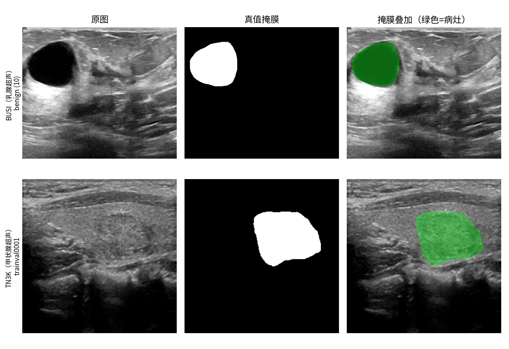
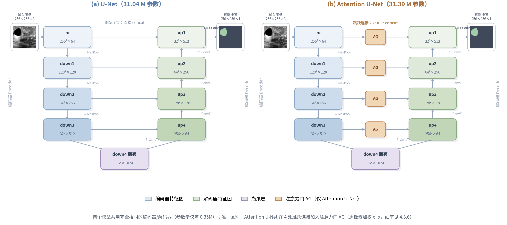
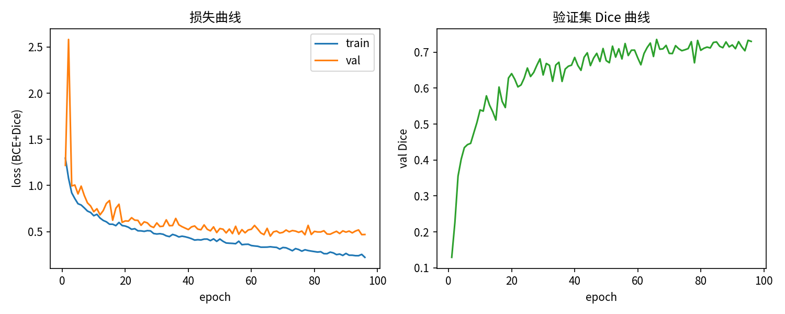
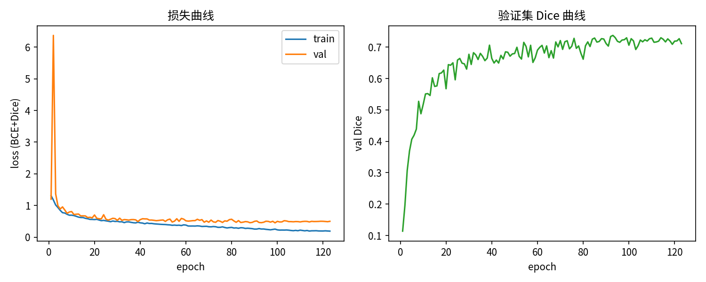
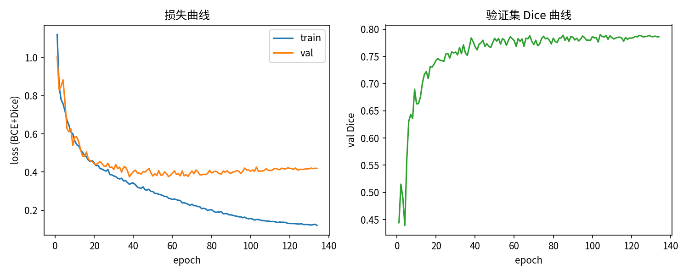
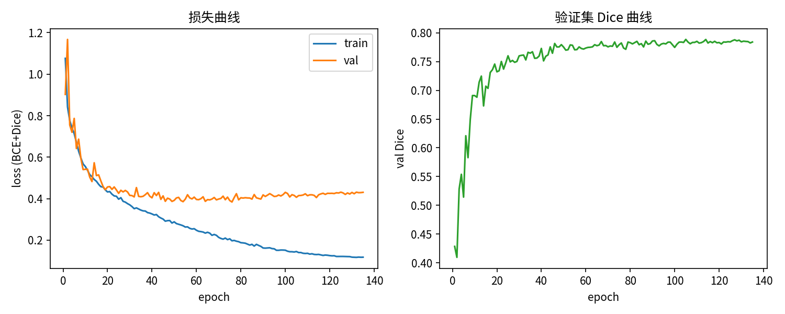
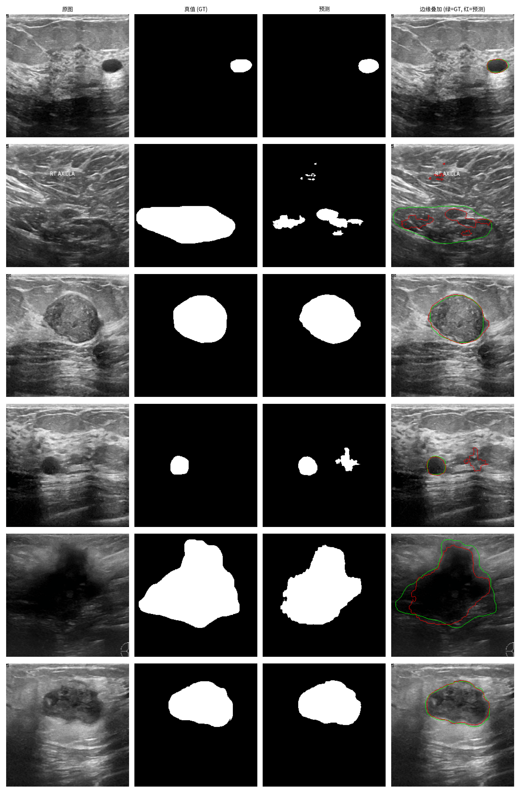
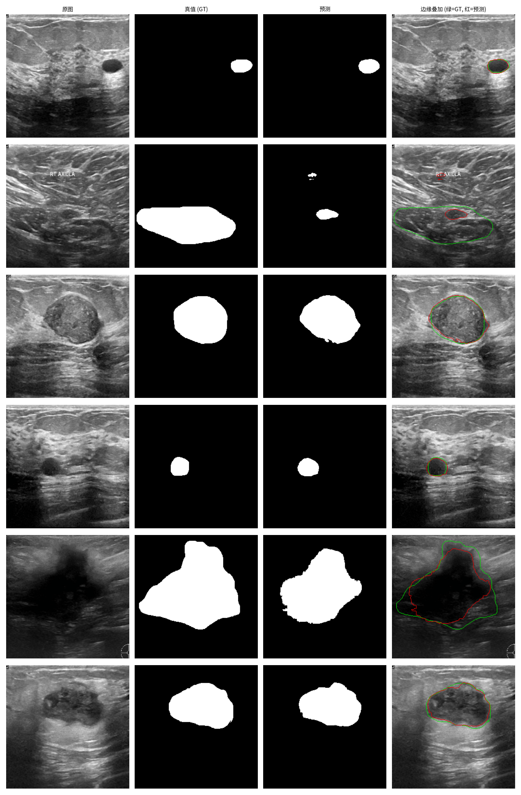
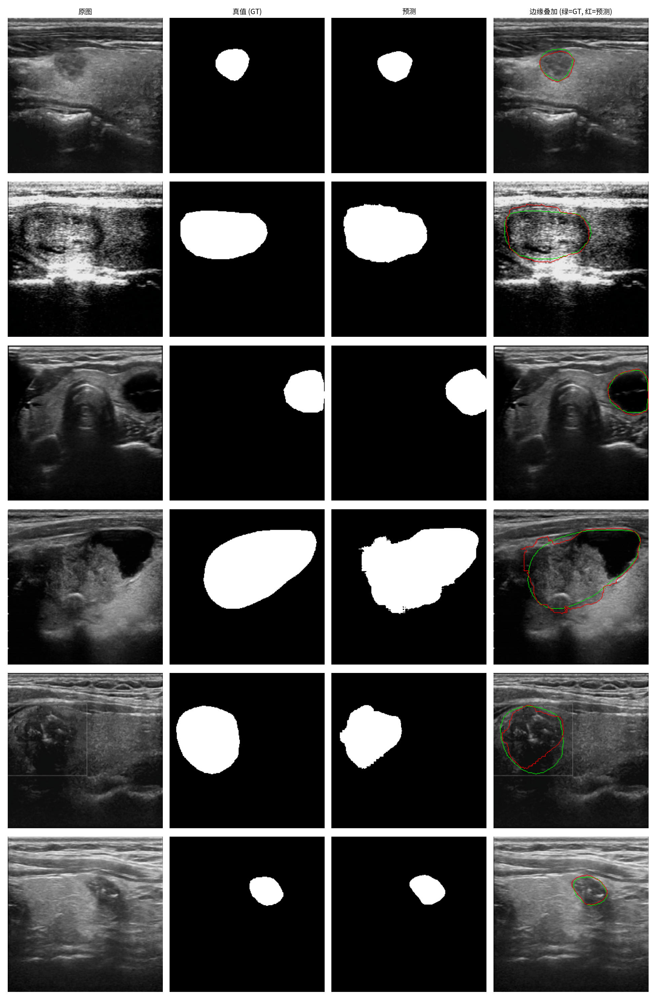
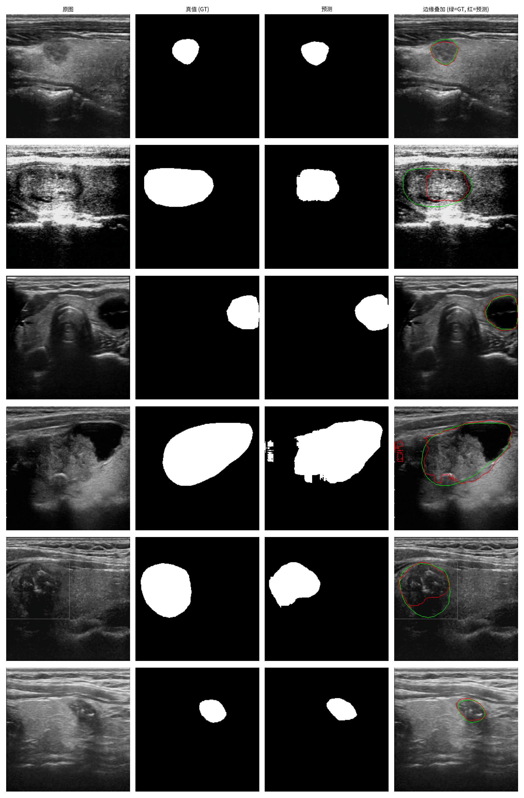

# 深度学习与医学应用课程设计——基于 U-Net 与 Attention U-Net 的超声病灶分割


---

## 1. 实验背景

医学影像的识别（recognition）、分割（segmentation）和解析（parsing）是医学影像分析的核心任务。医学影像识别是指识别医学图像中的目标；一旦完成识别或检测，得到目标的最小外包矩形框（bounding box），就可以通过分割任务寻找目标物体的精确边界。当图像中存在多个目标物体时，对多个目标的分割就变成了语义解析的任务，即对 2D 图像或 3D 图像中的像素赋予语义标签（Semantic Labels），通过将同一目标的像素打上相同的标签，就完成了对该目标的分割。

其中，**医学图像分割**是临床辅助诊断的关键环节：医生需要从影像中勾画出病灶的确切形状和边界，才能进行体积测量、良恶性判断和后续治疗规划。而人工勾画不仅耗时耗力，还高度依赖医生的经验，不同医生之间的标注一致性难以保证。

在众多医学成像模态中，**超声成像**具有无辐射、实时、成本低、可床旁检查等优点，是乳腺癌和甲状腺结节筛查的一线手段。但超声图像也有明显的缺点：斑点噪声严重、对比度低、病灶边界模糊，分割难度大。因此，利用深度学习实现超声图像病灶的**自动化分割**具有很高的临床价值。

2015 年，Ronneberger 等人提出的 **U-Net** 成为医学图像分割领域的里程碑式模型，其"编码器-解码器 + 跳跃连接"的结构至今仍是各类医学分割任务的标配基线。2018 年，Oktay 等人进一步提出 **Attention U-Net**，在跳跃连接处引入注意力门控机制，让网络自动学习"该关注哪里"，抑制无关背景区域。本课程设计正是以这两个模型为研究对象，在**乳腺超声（BUSI）**和**甲状腺超声（TN3K）**两个公开数据集上开展分割实验与对比分析。

## 2. 实验目的与意义

在理解了上述研究背景之后，接下来便需要决定如何去探究并实现医学图像分割的功能。本次课程设计中，我们选择 **U-Net 与 Attention U-Net 两个模型**，在**两个不同器官、同一模态（超声）的数据集**上进行训练与评估，目的如下：

1. 完整掌握深度学习医学图像分割的实验流程：数据集处理与划分、数据增强、模型搭建、训练调优、指标评估与结果可视化；
2. 通过**公平对比**理解注意力机制对分割性能的影响：两个模型共用完全相同的编码器/解码器结构，唯一区别是 Attention U-Net 在跳跃连接处加入了注意力门，这样可以排除骨干网络差异带来的干扰，得到可靠的对比结论；
3. 通过两个数据集的交叉验证（乳腺病灶 vs 甲状腺结节），分析模型在不同病灶形态、不同成像习惯下的表现差异，理解"同一类任务、不同数据分布"对模型的影响；
4. 熟悉 PyTorch 深度学习框架以及语义分割常用工具链（albumentations 数据增强、scipy 距离变换计算边界指标等），为以后的科研道路打下基础。

## 3. 环境搭建与数据集

### 3.1 环境搭建

| 项目 | 配置 |
|---|---|
| 操作系统 | Linux（Ubuntu），CUDA 12.2 |
| Python | 3.10（conda 环境） |
| 深度学习框架 | PyTorch 2.5.1 + cu121 |
| GPU | NVIDIA RTX 3070（8GB 显存） |
| 主要库 | albumentations 2.0.8（数据增强）、Pillow（图像读取）、scipy 1.15（距离变换/HD95）、numpy 1.26.4、tqdm、matplotlib |

项目代码结构如下（共 7 个脚本，职责单一、可复现）：

```
src/
├── make_splits.py   # 生成数据集划分文件
├── dataset.py       # 数据集读取与数据增强
├── models.py        # U-Net / Attention U-Net 模型定义
├── metrics.py       # Dice/IoU/SE/SP/ACC/HD95 指标计算
├── train.py         # 统一训练脚本
├── evaluate.py      # 测试集评估与可视化
└── summarize.py     # 四组实验结果汇总
run_all.sh           # 一键跑完 2 模型 × 2 数据集
```

> **遇到的实际问题**：安装依赖时 pip 自动将 numpy 升级到了 2.x，与环境中原有的 tensorflow 2.15（要求 numpy<2）产生冲突。解决办法是将 numpy 固定回 1.26.4 并在 README 中记录"安装依赖时勿升级 numpy"。

### 3.2 数据集准备

本次实验使用两个公开的超声图像分割数据集：

**（1）BUSI（乳腺超声数据集）**

- 数据来源：Al-Dhabyani 等人发布（Data in Brief 2020），本实验通过 ModelScope 镜像下载官方 `Dataset_BUSI.zip`；
- 数据内容：780 张乳腺 B 超图像（PNG 格式），采集自约 600 名女性患者，分辨率约 500×500，分为三个子目录：benign（良性）437 张、malignant（恶性）210 张、normal（正常）133 张；
- 标签：① 图片级类别标签 = 所在目录名（良性/恶性/正常）；② 像素级分割掩膜：每张图配一张 `X_mask.png`（1-bit 黑白 PNG，白色像素 = 病灶区域），个别良性图有多张掩膜（`X_mask_1.png`），读取时取逐像素最大值合并；
- 本实验处理：**剔除 normal 类**（正常乳腺没有病灶区域，掩膜为空，无法参与二值分割的指标评估），剩余 647 张（437+210）用于实验；
- 数据划分：该数据集**没有官方划分**，我们按类别分层做 8:1:1 的划分（固定随机种子 42，保证可复现），最终 训练 517 / 验证 64 / 测试 66。

**（2）TN3K（甲状腺结节超声数据集）**

- 数据来源：Gong 等人（ISBI 2021），数据采集自南方医科大学珠江医院，原始发布在 GitHub；本实验通过 HuggingFace 国内镜像（hf-mirror）下载重打包版本；
- 数据内容：3493 张甲状腺超声图像，来自 2421 名患者，原始分辨率跨度较大（216×217 ~ 1463×771），本镜像包内已统一为 256×256，另有 3493 个对应掩膜；
- 标签：仅像素级分割掩膜（标注结节区域），**无良恶性分类标签**。由于掩膜经过重采样，像素值不是标准的 0/255，而是 0~255 的连续值（抗锯齿边缘），统一按 `>127` 二值化；
- 数据划分：使用数据集**官方划分**：训练 2303 / 验证 576 / 测试 614。

**下载地址（复现用）**：

```bash
# BUSI
curl -L -o data/downloads/Dataset_BUSI.zip \
  "https://modelscope.cn/api/v1/datasets/yurkie/busi/repo?Revision=master&FilePath=Dataset_BUSI.zip"
# TN3K
curl -L -o data/downloads/ThyroidNodule-TN3K.zip \
  "https://hf-mirror.com/datasets/us-segmentator/us-segmentation-dataset/resolve/main/zips/Thyroid/ThyroidNodule-TN3K.zip"
```

两个数据集虽然同为"超声病灶二值分割"任务，但差异明显：**器官不同**（乳腺 vs 甲状腺）、**病灶形态不同**（乳腺病灶通常面积大、形态多样；甲状腺结节相对集中于图像中部、边界更模糊），因此对比实验能反映模型跨数据分布的稳定性。



图 1 数据集样例（上行：BUSI 乳腺超声 benign (10)；下行：TN3K 甲状腺超声 trainval0001。从左至右：原图、真值掩膜、掩膜叠加[绿色为病灶区域]）

## 4. 实验步骤

### 4.1 初始设置

训练脚本开始前进行以下固定设置，保证实验可复现、训练过程可控：

1. **随机种子固定**：Python、numpy、PyTorch（含 CUDA）统一设为 seed=42，保证划分、数据打乱顺序、参数初始化一致，两组模型对比时排除随机性干扰；
2. **混合精度训练（AMP）**：RTX 3070 上使用 `torch.amp` 自动混合精度，前向/反向用 float16、参数更新用 float32，显存占用明显降低、训练速度提升，同时用 GradScaler 防止 fp16 梯度下溢；
3. **早停机制（EarlyStopping）**：每个 epoch 结束后在验证集上计算 Dice 系数，若连续 30 个 epoch 没有提升则提前终止训练，防止过拟合、节省训练时间（相当于 Keras 中的 EarlyStopping 回调）；
4. **最优模型保存（ModelCheckpoint）**：只保存验证集 Dice 最高的权重（`outputs/checkpoints/{model}_{dataset}_best.pth`），训练结束用该权重做测试集评估；
5. **学习率调度（余弦退火）**：学习率从 1e-3 按余弦曲线逐渐降到 1e-5，前期大步快跑、后期小步精调（相当于 ReduceLROnPlateau 的平滑版本）；
6. **训练日志与曲线**：每个 epoch 记录 train_loss / val_loss / val_dice / 学习率 / 耗时到 CSV，训练结束后自动绘制损失曲线和 Dice 曲线。

### 4.2 数据预处理

**（1）尺寸统一与归一化**

两个数据集原始分辨率不一致（BUSI 约 500×500，TN3K 已为 256×256），统一缩放到 **256×256**（双线性插值，掩膜用最近邻插值避免引入非 0/1 像素），送入网络前做 ImageNet 均值/方差归一化。

归一化的意义：将像素值从 [0,255] 映射到零均值、单位方差的分布，提升网络收敛速度、减少训练时间，同时保证不同通道（R/G/B）的数值量级一致，避免"数值大的特征主导损失"的问题。

**（2）掩膜处理**

- 二值化：像素值 `>127` 视为病灶前景（1），否则视为背景（0）；TN3K 掩膜因重采样存在 0~255 的连续值，该阈值将其还原为二值标签；BUSI 掩膜本身为 1-bit 图像，转灰度后天然是 0/255；
- 多掩膜合并：BUSI 中个别图像有多张掩膜（不同医生的标注或同一病灶的不同区域），逐像素取最大值合并为一张；
- 标签形式：本任务是二值语义分割，标签是单通道 0/1 掩膜（不需要分类任务的 one-hot 编码）。

**（3）数据增强（仅训练集）**

超声图像训练样本有限（BUSI 仅 517 张训练图），必须依靠数据增强扩充样本的多样性。我们采用 albumentations 实现了以下增强：

| 增强方式 | 参数 | 设置理由 |
|---|---|---|
| 水平翻转 | p=0.5 | 病灶左右位置无解剖学含义，翻转不改变标签语义 |
| 随机旋转 | ±25°，p=0.5 | 探头角度变化等效于图像旋转，模拟不同扫描角度 |
| 缩放平移 | 缩放 0.9~1.1、平移 ±5%，p=0.5 | 模拟不同探头距离、不同病灶大小 |
| 亮度对比度扰动 | ±0.2，p=0.3 | 模拟不同设备增益和成像参数 |

> 说明：验证集和测试集**不做任何增强**，只做 resize + 归一化，保证评估结果客观。超声图像不同于自然图像，旋转、翻转是物理合理的（探头角度可变），而过度激进的形变（如大幅度弹性形变）可能破坏解剖结构，因此没有采用。

### 4.3 构建模型

#### 4.3.1 卷积层（Conv2d）

卷积层是网络的特征提取器，内部包含多个卷积核，每个卷积核对应一个权重系数和偏差量。本实验的两个模型均采用 **3×3 小卷积核**，并堆叠两层（DoubleConv：Conv3×3 → BN → ReLU，重复两次）。

关于卷积核设计的两点思考：

1. **为什么用小卷积核？** 两个 3×3 卷积层的感受野等于一个 5×5 卷积层，但参数更少（2×3²=18 < 5²=25），并且多了一次非线性激活，表达能力更强——这就是 VGG 提出的"小而深"设计哲学；
2. **padding 取 1**：保持卷积后特征图尺寸不变，使编码器各层特征尺寸与解码器严格对齐，便于跳跃连接拼接。

#### 4.3.2 批归一化层（BatchNorm）

在每个卷积层后加入 BN 层，将每层输出重新标准化为零均值单位方差。作用：缓解内部协变量偏移、加速收敛、允许更大的学习率，同时有一定的正则化效果。

#### 4.3.3 激活函数层（ReLU）

激活函数负责将神经元的输入映射到输出端，为网络引入非线性。本实验采用 **ReLU**（f(x)=max(0,x)）：相较于 Sigmoid 函数，ReLU 在正区间梯度恒为 1，不会由于两端饱和产生梯度弥散现象——使用 Sigmoid 时梯度下降法最初几层的权重变化非常缓慢，无法从样本中有效学习；ReLU 的负区间输出为 0，还天然带来稀疏激活，计算的导数也非常简单。

#### 4.3.4 下采样与上采样（池化 / 转置卷积）

- **编码器下采样**：使用 2×2 最大池化（MaxPool），每次将特征图长宽减半。作用：压缩特征图、扩大感受野、提取主要特征；池化层没有可学习参数，是控制参数量和计算量的重要手段；
- **解码器上采样**：使用转置卷积（ConvTranspose2d，2×2，步长 2）将特征图恢复一倍。相比双线性插值上采样，转置卷积的参数可通过训练学习，恢复效果更好。

#### 4.3.5 跳跃连接（Skip Connection）

这是 U-Net 的核心设计。编码器在下采样过程中不断提取高层语义，但同时丢失了精确的空间定位信息（病灶的边界在哪里）；解码器虽然能把语义信息还原回原图尺寸，但边界定位精度不足。**跳跃连接直接把编码器浅层的高分辨率特征拼接（concat）给解码器对应层**，使网络同时获得"深层的语义"和"浅层的位置"，从而精确分割出病灶边界。

#### 4.3.6 注意力门控（Attention Gate，Attention U-Net 的核心）

Attention U-Net 在每一处跳跃连接上加入了注意力门控。其计算过程为：

```
输入：g = 解码器上采样后的门控信号    x = 编码器浅层特征
α = Sigmoid( BN( Conv1×1( ReLU( BN(Conv1×1(g)) + BN(Conv1×1(x)) ) ) ) )   # 逐像素注意力权重 α ∈ [0,1]
输出 = x · α                                                              # 加权后的编码器特征再与解码器特征拼接
```

即：用解码器当前的"语义查询"（g）去审视编码器传来的特征（x），学习出每个像素的注意力权重 α，抑制超声背景中无关区域（斑点噪声、正常组织、图像标注文字等）的响应，让网络聚焦在病灶上。由于 α 与 g、x 的空间尺寸一致，加权是逐像素进行的（additive attention）。

#### 4.3.7 两个网络的完整结构与参数

两个模型共用完全相同的编码器/解码器，以输入 256×256×3 为例（每层为 `(Conv3×3+BN+ReLU)×2`）：

| 阶段 | 操作 | 输出尺寸 | 通道数 |
|---|---|---|---|
| inc | 双卷积 | 256×256 | 64 |
| down1 | MaxPool2 + 双卷积 | 128×128 | 128 |
| down2 | MaxPool2 + 双卷积 | 64×64 | 256 |
| down3 | MaxPool2 + 双卷积 | 32×32 | 512 |
| down4（瓶颈） | MaxPool2 + 双卷积 | 16×16 | 1024 |
| up1 | 转置卷积↑ + [注意力门] + 拼接 down3 + 双卷积 | 32×32 | 512 |
| up2 | 转置卷积↑ + [注意力门] + 拼接 down2 + 双卷积 | 64×64 | 256 |
| up3 | 转置卷积↑ + [注意力门] + 拼接 down1 + 双卷积 | 128×128 | 128 |
| up4 | 转置卷积↑ + [注意力门] + 拼接 inc + 双卷积 | 256×256 | 64 |
| 输出层 | Conv1×1（输出 logits） | 256×256 | 1 |

- **U-Net**：无注意力门，参数量 **31.04 M**；
- **Attention U-Net**：4 处跳跃连接各加一个注意力门（中间通道依次为 256/128/64/32），参数量 **31.39 M**。

两个模型参数量仅相差 0.35M（约 1%），差异全部来自 4 个注意力门——这为"注意力机制本身带来的性能变化"提供了非常干净的对比条件。



图 2 两个模型结构示意图（左：U-Net；右：Attention U-Net。方框内为特征图尺寸×通道数，两端为输入图像与输出掩膜的示例；两模型共用完全相同的编码器/解码器，唯一区别是右侧 4 处跳跃连接上的橙色注意力门 AG）

#### 4.3.8 损失函数与优化器

**损失函数 = BCEWithLogits + Soft Dice**：

- **BCE（二元交叉熵）**：逐像素评估预测概率与真实标签的差异，提供稠密的梯度信号，负责像素级的分类正确性；
- **Soft Dice**：`1 - (2·|P∩G|)/(|P|+|G|)`，直接优化预测区域与真值区域的重叠度。在医学分割任务中前景（病灶）通常只占图像的很小一部分（类别极度不平衡），若只用 BCE，网络把所有像素预测为背景也能获得很低的损失；加入 Dice 项可以强制网络关注前景区域。两项相加（等权重）是医学分割中最常用的组合。

**优化器 = Adam + 余弦退火**：

- 对比了三种梯度下降方式：批量梯度下降每次用全部数据更新，方向准但太慢且吃内存；随机梯度下降每次只用一个样本，速度快但震荡剧烈；**Adam** 结合二者优点，为每个参数自适应调整学习率（一阶矩 + 二阶矩估计），是当前最常用的选择；
- 学习率初始 1e-3，余弦退火至 1e-5；batch size 16；共训练 150 个 epoch（配合早停）。

## 5. 实验内容与结果

### 5.1 实验设计

采用 **2 模型 × 2 数据集** 的对比实验设计：每个模型在**每个数据集**上都独立完整地训练一次，共 4 组实验：

| 实验编号 | 模型 | 数据集 | 训练集/验证集/测试集 |
|---|---|---|---|
| 1 | U-Net | BUSI | 517 / 64 / 66 |
| 2 | Attention U-Net | BUSI | 517 / 64 / 66 |
| 3 | U-Net | TN3K | 2303 / 576 / 614 |
| 4 | Attention U-Net | TN3K | 2303 / 576 / 614 |

四组实验使用**完全相同**的预处理、增强策略、损失函数、优化器、训练轮数和随机种子，保证对比公平。

### 5.2 评价指标

- **Dice（DSC）** = 2|P∩G| / (|P|+|G|)：预测区域与真值区域的重叠度，医学分割最核心的指标，越接近 1 越好；
- **IoU（Jaccard）** = |P∩G| / |P∪G|：交并比，与 Dice 同向，数值上一贯比 Dice 小；
- **SE（敏感度/召回率）** = TP/(TP+FN)：病灶像素被正确检出的比例，衡量**漏检**程度，临床上最重要（漏检病灶后果严重）；
- **SP（特异度）** = TN/(TN+FP)：背景像素被正确识别的比例，衡量**误报**程度；
- **ACC（像素准确率）** = (TP+TN)/全部像素：整体正确率（超声图中背景占绝大部分，ACC 通常很高，单独看意义有限）；
- **HD95（95% Hausdorff 距离）**：预测边界与真值边界之间距离的 95 百分位数（单位：像素），衡量**边界贴合程度**，越小越好。传统 Hausdorff 距离取最大值，极易被个别离散噪点影响，HD95 剔除了最差的 5% 极端点，更加稳健。计算方式：分别求预测表面到真值表面、真值表面到预测表面两组最近距离，取合并后的 95 百分位数。

指标的选取遵循"区域重叠（Dice/IoU）+ 检出能力（SE）+ 误报（SP）+ 边界质量（HD95）"的多维度原则，单一指标无法全面反映分割质量。

### 5.3 训练过程分析

四组实验的训练曲线如下（每张图左为 train/val loss 曲线、右为验证集 Dice 曲线，曲线在早停触发处结束）：

| U-Net | Attention U-Net |
|---|---|
|  |  |
|  |  |

图 3~6 四组训练曲线（上排 BUSI、下排 TN3K；左列 U-Net、右列 Attention U-Net）

从曲线中可以读出以下规律：

1. **训练初期的下降节奏**：BUSI 上第一个 epoch 的验证 Dice 仅 0.11~0.13，验证 Dice 首次突破 0.7 分别用了 49 轮（U-Net）和 39 轮（Attention U-Net）；TN3K 由于数据量大、结节形态更规整，第一个 epoch 验证 Dice 就达到 0.43~0.44，13 轮内即突破 0.7。四组的 loss 曲线前段都下降陡峭，说明 BCE + Dice 组合提供的梯度信号良好。
2. **过拟合迹象与早停**：四组实验的验证 loss 都在训练中段到达最低点后缓慢回升（如 unet_tn3k 最低点 0.3749 出现在第 38 轮，末轮回升至 0.4194；attunet_busi 回升幅度最大，+0.048），而 train loss 仍在持续下降（TN3K 末轮已降至约 0.12）——出现了典型的训练/验证曲线分离。四组实验全部被早停机制拦下（最佳 epoch 后再等 30 轮），没有跑满 150 轮：BUSI 两组分别停在第 96 / 123 轮，TN3K 两组停在第 134 / 135 轮。
3. **两个模型在同一数据集上的收敛差异**：BUSI 上 Attention U-Net 前期收敛更快（39 轮 vs 49 轮突破 Dice 0.7）；TN3K 上两者起步几乎同步（12~13 轮突破 0.7），但 U-Net 率先到达 0.78（38 轮 vs 46 轮）。总体看，注意力门的额外参数与门控计算让收敛略慢半拍，但对最终平台高度的影响不大——两个模型的最佳验证 Dice 非常接近（BUSI 0.7353 vs 0.7375，TN3K 0.7903 vs 0.7887）。
4. **同一模型在两个数据集上的收敛差异**：TN3K 单轮耗时约为 BUSI 的 4 倍（36~40s vs 8.5~9.7s，训练集 2303 张 vs 517 张），但验证 Dice 上升更快、更平稳，最佳值也更高（约 0.79 vs 约 0.74）。这印证了"数据规模是深度学习的第一生产力"：TN3K 的样本量让小模型也不容易记牢训练集，泛化曲线更健康。

### 5.4 四组实验结果对比

四组实验在各自测试集上的最终结果见下表（均值±标准差；由 `python3 src/summarize.py` 自动汇总，原始文件 `outputs/metrics/comparison_table.md`）：

| 数据集 | 模型 | Dice | IoU | SE | SP | ACC | HD95 |
|---|---|---|---|---|---|---|---|
| BUSI | U-Net | 0.7490±0.2287 | 0.6428±0.2495 | 0.7652±0.2711 | 0.9802±0.0345 | 0.9566±0.0518 | **39.14**±38.71 |
| BUSI | Attention U-Net | **0.7564**±0.2443 | **0.6563**±0.2527 | **0.7726**±0.2713 | **0.9822**±0.0363 | **0.9575**±0.0553 | 41.63±57.59 |
| TN3K | U-Net | 0.8138±0.2094 | 0.7252±0.2263 | 0.8432±0.2257 | 0.9856±0.0233 | 0.9690±0.0423 | 31.88±55.75 |
| TN3K | Attention U-Net | **0.8217**±0.2071 | **0.7357**±0.2226 | **0.8441**±0.2244 | **0.9861**±0.0219 | **0.9703**±0.0411 | **31.05**±56.79 |

（加粗 = 同一数据集上两个模型中的较优值）

从上表可以读出四个层次的结论：

1. **横向对比（同一数据集、两个模型）**：Attention U-Net 在两个数据集上的 Dice 均小幅胜出——BUSI 0.7490→0.7564（+0.0074，相对 +1.0%），TN3K 0.8138→0.8217（+0.0079，相对 +1.0%），IoU、SE、SP、ACC 四个指标也全部略优。边界指标 HD95 则出现分歧：TN3K 上 Attention U-Net 更优（31.88→31.05），BUSI 上反而略差（39.14→41.63）。逐图统计更能说明问题：BUSI 的 66 张测试图中，Attention U-Net 提升（Dice 增量 >0.01）25 张、变差 28 张；TN3K 的 614 张中提升 235 张、变差 205 张——**注意力机制的增益是"统计意义上小幅为正"，而非每张图都变好**。
2. **纵向对比（同一模型、两个数据集）**：两个模型在 TN3K 上的表现全面优于 BUSI（Dice 高约 0.06~0.07，HD95 低约 8~10 像素，且各项指标的标准差更小）。这符合两个数据集的客观差异：TN3K 训练集是 BUSI 的 4.5 倍、结节形态更规整、官方划分保证训练/测试分布一致；BUSI 训练集仅 517 张，且病灶大小、形态、良恶性差异大。
3. **失败样本的结构差异**：BUSI 上 U-Net 没有一张完全漏检（SE=0），Attention U-Net 有 2 张完全漏检（3.0%）、Dice<0.5 的比例也略高（15.2% vs 12.1%）——它靠更多"大胜"的图（如 benign (256) Dice 0.11→0.43、benign (294) 0.57→0.90）把均值拉回来；TN3K 上两者完全漏检比例接近（2.6% vs 2.9%），Attention U-Net 的 Dice<0.5 比例更低（7.2% vs 8.1%）。
4. **与文献基线的对比**：文献在 BUSI 上 SOTA 级 Dice 约 80%（如 DCCE-UNet 79.85%），TN3K 约 89%~91%（DCCE-UNet 89.29%、UESA-Net 91.39%）。本实验分别为 0.756 / 0.822，低于文献值，主要原因：文献模型普遍使用更强的骨干与专门设计的多尺度模块（部分使用预训练），而本实验是从零训练（from scratch）的朴素 U-Net 基线，模型容量刻意保持一致以隔离注意力机制的作用。**另外，文献的数据划分与评价细节（是否剔除 normal、掩膜阈值、测试集大小）可能与本文不同，数值仅作量级参照。** 就结论而言，本实验"Attention U-Net 小幅优于 U-Net"的观察与文献中"注意力机制增益通常在 1~2 个百分点内"的普遍报告一致。

### 5.5 预测结果可视化与失败案例分析

四组实验的预测可视化如下（每行一张测试图，四列依次为：原图、真值掩膜、模型预测掩膜、边缘叠加[绿色 = 真值边缘，红色 = 预测边缘，两色重合表示分割准确]，行标签为图像名）：

| U-Net | Attention U-Net |
|---|---|
|  |  |
|  |  |

图 7~10 四组预测可视化（上排 BUSI、下排 TN3K；左列 U-Net、右列 Attention U-Net）

**典型成功案例**：两个数据集上绝大多数中小型病灶都被稳定分割——TN3K 测试集约 92% 的图像 Dice>0.5，叠加图中绿（真值）红（预测）两条边缘轮廓基本贴合，预测掩膜平滑、无明显碎片化假阳性；体积占比适中的单发结节效果最好。

**失败案例分析**（结合逐图指标挑选）：

- **案例一：BUSI malignant (181) —— 低对比度 + 声影干扰，两个模型均完全漏检**。U-Net 的 Dice 仅 0.009（SE=0.025），Attention U-Net 直接全图预测为背景（Dice=0，在 HD95 的空预测惩罚下取图像对角线 362 像素）。该图病灶位于左上象限，灰度与周围组织几乎没有差异，且图像下半部分是大片声影形成的极暗区域，病灶边界信息严重丢失，模型难以定位。这说明**超声分割的性能瓶颈首先在图像质量本身，而非模型容量**。
- **案例二：BUSI benign (201) —— Attention U-Net 反而完全失效**。U-Net 的 Dice 为 0.506，Attention U-Net 为 0。该病灶是一块细长的"月牙形"低回声区（图中左侧还有超声仪自动叠加的"LT"文字标注），面积小、对比度低。注意力门把这块弱响应区域整体抑制掉了，而 U-Net 至少检出了一半；类似的例子还有 benign (199)（Dice 0.39→0.11）。**这是注意力机制少数几种变差模式的主要来源**——"抑制无关区域"的能力在极端情况下会把弱响应病灶一并抑制。
- **案例三：TN3K 上两者互有胜负**。test0369 上 U-Net Dice 0.63 而 Attention U-Net 几乎全崩（0.002）；反向的 test0397 则是 U-Net 完全漏检（0.0）而被 Attention U-Net 成功找出（0.776）。在样本量充足时，两个模型的错误模式存在互补性，单张图的胜负带有随机性，只有统计平均才有意义。

此外，从预测图还可以观察到两类系统性误差：① **过分割**：在亮暗交界处（腺体包膜、声影边缘），预测掩膜越出真值边界（叠加图中红色边缘落在绿色外侧）；② **小目标漏检**：TN3K 中约 2.6%~2.9%、BUSI（Attention U-Net）中 3.0% 的图像被完全漏检（SE=0）。对 TN3K 的 21 张漏检图做统计发现，其真值掩膜面积中位数仅 0.73%，远小于测试集整体的 7.03%，其中 76%（16/21）属于面积最小的 20% 样本——**小目标是完全漏检的首要原因**。至于"Attention U-Net 在带文字标注图像上是否更稳"，本实验的样本中两种模型对文字标注的抗干扰表现没有明显差异（BUSI 的 66 张测试图中仅少数含标注文字，不足以支撑统计结论）。

### 5.6 讨论

- **注意力机制的增益是否一致？** 方向上一致（两个数据集 Dice 均为正增益）、幅度上高度一致（+0.0074 / +0.0079，约 +1% 相对值），但边界质量上不一致（TN3K 的 HD95 变好、BUSI 变差）。原因可以从注意力门的机制理解：它的作用是给编码器浅层特征逐像素加权、抑制背景响应，而 U-Net 通过"上采样语义 + 浅层细节拼接"已经能较好地区分病灶与背景，门控在特征层面的边际收益因此有限。当背景干扰强、病灶弱时（如 BUSI 的个别低对比度病灶），门控有概率"连病灶一起抑制"，这就是逐图看涨跌互现的原因。
- **乳腺病灶与甲状腺结节的难度差异**：BUSI 病灶面积大、形态多样（分叶、毛刺、不规则），常伴大片声影，病灶大小差异也大——体现在 HD95 的均值高（39~42 像素）、方差极大（标准差 38~58 像素）；TN3K 结节面积小但位置集中、边界相对清晰，加上训练集大 4.5 倍，全部指标显著更优。对本任务的两个模型来说，**数据规模与标注一致性对结果的影响大于病灶形态本身**。
- **从 HD95 与 Dice 的差异看"区域重叠好但边界差"**：HD95 对少数完全漏检或远距离假阳性极为敏感（空预测惩罚取对角线 362 像素）。BUSI 上 Attention U-Net 的 Dice 更高但 HD95 更差，正是因为它在 2 张图上完全漏检（SE=0）——平均 Dice 高不代表没有严重错误。临床上漏检与误报的代价完全不同，这也是本文同时报告 SE/SP/HD95 而非只看 Dice 的原因。
- **无预训练 + 小数据集的影响**：四组实验全部 from scratch 训练，BUSI 仅 517 张训练图，验证 loss 早在中期就开始回升（过拟合迹象明显），这是与文献 SOTA 差距的主要来源之一（另一个是文献模型结构更强）。可能的改进方向：ImageNet/超声大数据预训练编码器、更强的增强策略、5 折交叉验证降低单次划分方差、测试时增强（TTA）等。

## 6. 主要创新

1. **严格的公平对比设计**：许多同类对比实验直接使用不同来源的模型（一个用官方实现、一个自己实现，或编码器骨干不同），对比结果混杂了实现细节、骨干网络、预训练权重的差异，无法归因。本实验将两个模型写在**同一份代码**中，共用完全相同的编码器和解码器，唯一区别是 4 个注意力门（参数量差异仅 0.35M/1%），使性能差异可以干净地归因于注意力机制本身；
2. **同任务跨器官的数据集组合**：BUSI（乳腺）与 TN3K（甲状腺）同为超声二值分割任务，但病灶形态和标注风格差异大，可从两个数据集的结论一致性上分析模型的鲁棒性；
3. **多维度指标评估**：除常用的 Dice/IoU/ACC 外，引入 SE/SP（临床视角的漏检/误报）和 HD95（边界质量），并自主用 scipy 距离变换实现了稳健的 HD95，避免了直接从第三方库黑盒调用；
4. **规范化的数据处理流程**：针对实际数据的具体问题做了针对性处理——BUSI 多掩膜最大值合并、normal 类剔除的依据（空掩膜无法评估）、TN3K 非标准掩膜值的二值化阈值（>127）、HD95 中空预测的对角线惩罚等，这些细节在公开代码中经常被忽略却直接影响评估的公平性；
5. **完整的可复现工程**：一键脚本 `run_all.sh` 可复现全部 4 组实验，划分文件固定随机种子，训练日志、曲线、逐图指标全部自动保存。

## 7. 系统分析

### 7.1 对本次项目的总体分析

**完成度**：4 组实验（2 模型 × 2 数据集）全部按预定协议（相同预处理、增强、损失函数、优化器、随机种子）完成训练与测试，训练曲线、逐图指标、可视化图全部自动留档，任意一组结果均可一键复现。

**结果是否达到预期**：达到。两个模型在 BUSI 上 Dice 0.749~0.756、TN3K 上 0.814~0.822，处于"朴素 U-Net 基线、无预训练"的合理区间；Attention U-Net 在两个数据集上均以约 +1%（相对）的幅度小幅胜出，与文献中该模块"小幅正向"的定位一致。工程上，混合精度 + 早停使四组实验在单张 RTX 3070 上一天内全部完成，训练过程未出现崩溃或不可复现的问题。

**两个模型差异是否符合预期**：符合。预期就是"注意力机制带来小幅提升、但并非每张图都更好"——逐图统计（BUSI 25 胜 28 负、TN3K 235 胜 205 负）精确刻画了这种"有得有失、平均小胜"的模式，也解释了 HD95 在 BUSI 上反而变差的原因（2 张完全漏检的图被距离惩罚放大）。

**相比文献的差距及原因**：BUSI 差约 4 个 Dice 点（0.756 vs 79.85%），TN3K 差约 7~9 个点（0.822 vs 89.29%~91.39%）。差距主要来自：① 文献模型（DCCE-UNet、UESA-Net 等）使用专门设计的多尺度、密集连接模块，且多采用预训练；② 文献的划分与评价细节可能与本文不同（是否含 normal 类、测试集大小），数值本身不完全可比；③ 本文的定位是"同一骨架下的公平对比"——刻意保持模型容量一致（31M、无预训练），以隔离注意力机制本身的作用，因此绝对精度的优先级低于对比的公平性。

### 7.2 项目进行中遇到的问题及解决方法

**（1）数据下载问题**
GitHub、Google Drive、HuggingFace 等站点在实验网络环境下无法直连，TN3K 官方下载渠道（GitHub）和 BUSI 官方网站（有反爬检测）均不可用。解决方法：找到国内可访问的镜像——BUSI 使用 ModelScope 镜像的官方 `Dataset_BUSI.zip`（下载后与官方文件逐字节一致，206MB），TN3K 使用 hf-mirror 的 US30K 重打包版本（123MB），并校验 zip 完整性。

**（2）依赖版本冲突**
安装 albumentations 等包时 pip 自动升级 numpy 到 2.x，导致环境中原有的 tensorflow 2.15 无法工作。解决方法：将 numpy 固定回 1.26.4（torch 2.5 兼容），并在文档中明确记录，避免他人复现时踩坑。

**（3）BUSI 掩膜的读取方式**
直接用 PIL 打开 BUSI 掩膜得到的是布尔数组（True/False），因为它是 1-bit PNG 图像；若按 0/255 的假设处理会出错。解决方法：读取时先 `convert("L")` 转为 8 位灰度（True→255），再统一按 `>127` 二值化。

**（4）TN3K 掩膜不是标准二值图**
官方 ReadMe 特意提示"label not all is 0 or 255"：掩膜经过缩放重采样，边缘是 0~255 的连续值（抽样 300 张全部存在 16~24 个不同灰度值）。若按"非 0 即前景"处理会把抗锯齿的浅色边缘也当病灶，导致边界偏胖。解决方法：统一阈值 `>127` 二值化，两个数据集采用同一标准。

**（5）normal 类图像无法参与分割评估**
BUSI 的 normal 类（133 张）没有病灶区域，其掩膜为全零。若纳入测试集，Dice 的分母为零（约定返回 0 或 1 都不合理），指标失去意义。解决方法：剔除 normal 类（与多篇使用 BUSI 的论文做法一致），并在数据说明中明确记录 647 张的依据。此外保留了 `--include-normal` 开关以便需要时复现完整 780 张版本。

**（6）HD95 对空预测的惩罚设定**
测试集中若模型对某张图完全没预测出前景（预测掩膜为空）而真值非空，HD95 理论上是无穷大。直接丢弃该样本会让指标虚高。解决方法：约定"一方为空"时返回图像对角线长度作为惩罚（本实验 256×256 图像为 362.04），使严重漏检在指标上真实体现。

**（7）可视化图中文标题显示为方框**
matplotlib 默认字体（DejaVu Sans）不含中文字形，保存的曲线图、预测图标题全是方框。解决方法：在绘图前检测并设置系统可用的中文字体（Noto Sans CJK / Droid Sans Fallback），并关闭 unicode-minus 渲染问题。

**（8）训练监控日志被进度条刷屏**
tqdm 进度条会把日志文件写满控制字符，直接 grep 查看体验差。解决方法：用 `tr '\r' '\n'` 预处理后再过滤每轮的汇总行，方便随时检查训练状态。

## 8. 总结与提升

经过本次项目，我们小组完整实现了基于 U-Net 与 Attention U-Net 的超声病灶分割系统，在两个公开数据集上完成了 4 组训练与评估实验，并加深了对深度学习、医学图像分割和注意力机制的理解。我们的结论如下：

1. **"编码器-解码器 + 跳跃连接"是医学分割的有效范式**：U-Net 结构简洁（31M 参数）、训练稳定，在两个数据集上都能从零训练获得可用的分割精度（BUSI Dice 0.749，TN3K Dice 0.814），且无需任何预训练；
2. **注意力机制的作用**：Attention U-Net 相比 U-Net 在两个数据集上 Dice 均提升约 0.8 个点（BUSI 0.7490→0.7564、TN3K 0.8138→0.8217，相对提升约 1%），IoU/SE/SP/ACC 齐步微涨；但增益幅度小、逐图涨跌互现（TN3K 235 涨 205 跌），HD95 一好一坏，说明门控在抑制背景的同时偶有误伤弱响应病灶——"注意力机制带来小幅但不稳定的正向收益"；
3. **数据集难度差异**：TN3K 数据量是 BUSI 的 4.5 倍、结节形态规整、划分官方一致，两个模型在 TN3K 上的全部指标都显著优于 BUSI（Dice 高约 0.06，HD95 低约 8~10 像素，指标方差也更小）；BUSI 病灶形态多样、常伴声影，HD95 方差极大，是"小数据集 + 高难度样本"的典型组合；
4. **工程规范的重要性**：数据下载、掩膜处理、指标定义中的每一个细节（如空掩膜、非标准标签值）都会直接影响实验结论的可信度，规范的流程和记录与模型本身同样重要。

**未来改进方向**：

1. **交叉验证**：BUSI 测试集仅 66 张，单次划分存在方差，可做 5 折交叉验证并报告均值±标准差；
2. **更强的分割模型**：U-Net++（嵌套密集跳跃连接）、Attention U-Net 的变体、以及 Transformer 类模型（TransUNet、Swin-UNet）——文献表明其在边界模糊的小目标上可能更优，但已超出"CNN 模型"的选题范围，可作展望；
3. **训练策略改进**：引入 ImageNet 预训练编码器（ResNet34 等）、深监督、更强的损失组合（Focal+Dice）、后处理（最大连通域去除小碎块）；
4. **临床可用性分析**：添加预测结果与医生标注的距离分析、分割置信度估计，以及与临床医生的主观评估对比。

---

## 附：图表清单

| 编号 | 内容 | 来源文件 |
|---|---|---|
| 图1 | 数据集样例（原图+掩膜） | `outputs/figures/dataset_samples.png` ✅ 已生成 |
| 图2 | 两个模型结构示意图 | `outputs/figures/model_architectures.png` ✅ 已生成 |
| 图3~6 | 四组训练曲线 | `outputs/figures/*_curves.png` ✅ 自动生成 |
| 图7~10 | 四组预测可视化 | `outputs/figures/*_predictions.png` ✅ 自动生成 |
| 表1 | 数据集统计 | 本文档 3.2 节 |
| 表2 | 模型结构与参数 | 本文档 4.3.7 节 |
| 表3 | 四组实验结果对比 | `outputs/metrics/comparison_table.md` ✅ 自动生成 |
